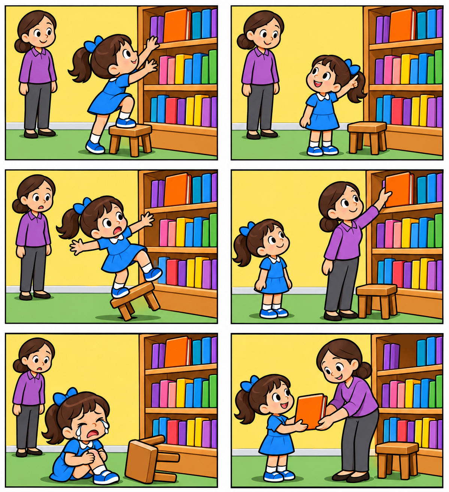
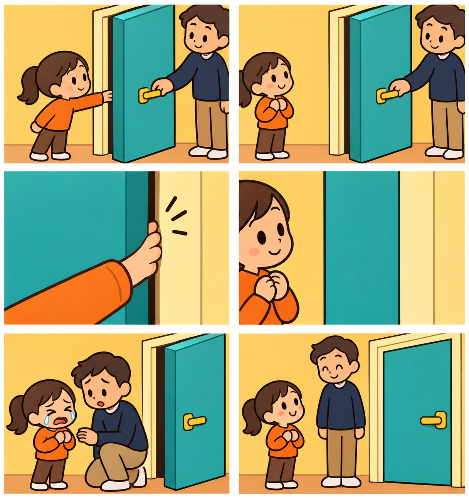
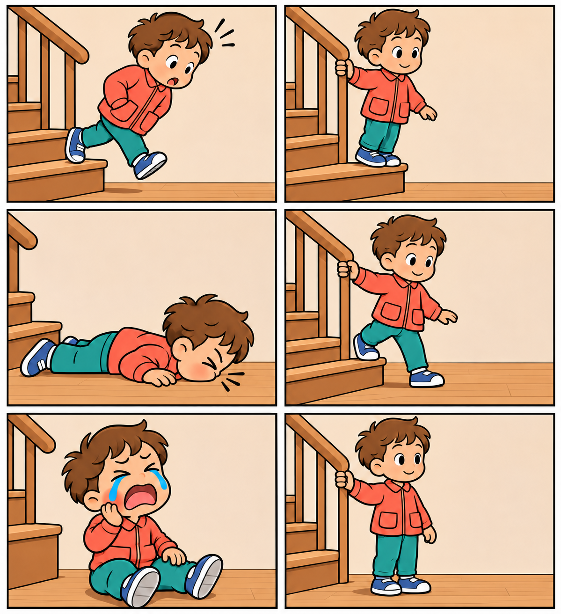
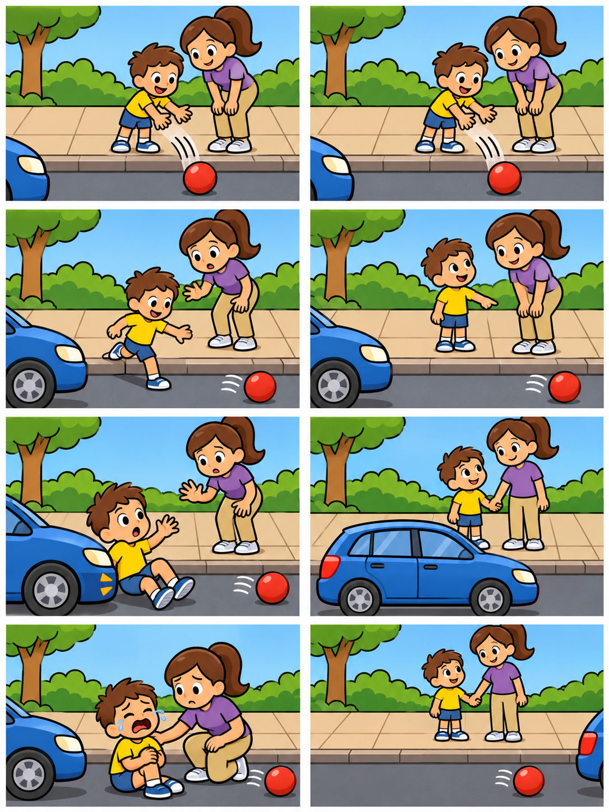

# 亲子安全对照图

一个为 3–6 岁孩子制作无字安全漫画的 Codex Skill。家长用一句话描述场景和担心的动作，选定分镜后，就能拿到一张两列对照图。左列画危险动作和可能的后果，右列画孩子能照着做的安全动作。

## 怎么用

1. 在具备生图工具的 Codex 会话中加载 [亲子安全对照图 Skill](child-safety-comic/SKILL.md)。
2. 描述一个场景，例如「孩子下楼总把手插兜里，我想让他看看怎么扶着扶手走」。
3. 看完 A、B 两种分镜选一个，也可以补一句「最后别画哭」。选定后会生成一张无字漫画，并附一句家长可以当场说的话。

## 漫画示例

### 够高处的书

孩子可以把想要的书指给大人看，站在地面等大人递过来。

### 关门夹手

中间一行放大门边，画出手指伸进门缝和双手收在胸前的区别。

### 下楼扶扶手

左列画出踩空、脸颊碰地和捂脸哭泣，右列画出握稳扶手再下楼。

### 路边追球

用路沿标出该停的位置，再用车头和驶离的车尾交代车辆方向。

## 出图标准

- 两列、两到四行，默认供孩子和家长在手机上一起看。
- 后果用清楚的接触点、失衡、缩手或哭泣等动作和表情表现。画面保持无血腥、无伤口。
- 交付前检查左右的因果顺序、人物与物体的位置连续性，以及每个人的手臂、手指和抓握动作。
