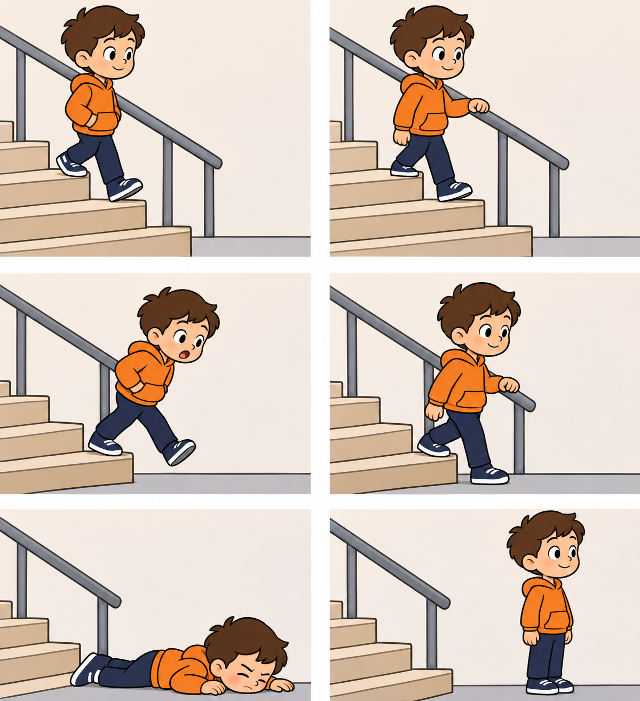

# 亲子安全对照图

一个为 3–6 岁孩子制作无字安全漫画的英文 Skill。家长可以用中文描述场景。信息不足时，助手会分轮帮助家长选定想教的动作，再确定分镜。左列画危险动作和可能的直接影响，右列画孩子能照着做的安全动作和自然结局。

## 怎么用

1. 在会话中加载 [英文 Skill](child-safety-comic/SKILL.md)，描述场景。例如说「我家孩子滑滑梯有点危险」。助手会先让你在「等出口空了再滑」「坐稳、脚朝前」「滑到底后离开出口」等教学目标中选一个。
2. 确定目标后，选故事画到哪里，例如「画到两人碰一下」或「继续画到大人过来」。助手会从两边的结局倒推过程，再给出格数和分镜供确认。
3. 确认后逐格生成。使用外部工具时，每次复制一格的英文提示词，按清单保存为 `r1-left.png`、`r1-right.png` 等。能上传参考图时，后续各格可附上已选定的起始格。按每格的动作说明核对，遮住接触点或画错动作时单独重画该格。
4. 将同一故事的单格放进一个目录。安装 Python 3 和 Pillow 9.1 或更高版本后，在仓库根目录运行 `python child-safety-comic/scripts/assemble.py panels --rows 3 --output comic.png`。把 `panels` 换成图片目录，行数可选 2、3、4，输出使用新文件名。脚本接受 PNG、JPEG 和 WebP，保留完整画面并加白色格间距。

想在另一款能对话的生图工具里从头选择，可以先粘贴 [英文交互提示词](child-safety-comic/references/interactive-prompt.txt)，再描述场景。只接收生图指令的工具可直接使用选定后的英文画稿提示词。

## 漫画示例

可以按事情发生的地方找例子，也可以按想讲清的动作找分镜。

| 按生活场景 | 按分镜重点 |
| --- | --- |
| [居家生活](examples/by-setting/home/) | [碰到危险物](examples/by-action/hazardous-contact/) |
| [出门与交通](examples/by-setting/traffic/) | [身体失去支撑](examples/by-action/loss-of-support/) |
| [游乐与运动](examples/by-setting/play-and-sports/) | [进入移动路线](examples/by-action/crossing-paths/) |
| [公共场所与集体活动](examples/by-setting/public-and-group/) | [主动开口求助](examples/by-action/asking-for-help/) |
| [户外、自然与动物](examples/by-setting/outdoors-and-animals/) |  |

### 够高处的书

孩子可以把想要的书指给大人看，站在地面等大人递过来。

### 关门夹手

中间一行放大门边，画出手指伸进门缝和双手收在胸前的区别。

### 下楼扶扶手

左列画出下楼、踩空和脸颊触地，右列画出握稳扶手、逐步走到平地。

### 路边追球

用路沿标出该停的位置，再用车头和驶离的车尾交代车辆方向。

## 出图标准

- 默认两列三行，每列都有起始、过程和结果。碰撞与事后反应需要分开看时，加到四行。明确要求四格时，可以选精简剧情。
- 图中只画人物、动作、相关物体和必要环境。家长来讲述。睁开的眼睛画出清晰的眼白、深色虹膜和较小的瞳孔。
- 用接触、失衡、缩手等动作画清直接影响，按场景决定是否出现眼泪。画面保持无血腥、无伤口。
- 交付前检查左右的因果顺序、人物与物体的位置连续性，以及每个人的手臂、手指和抓握动作。
